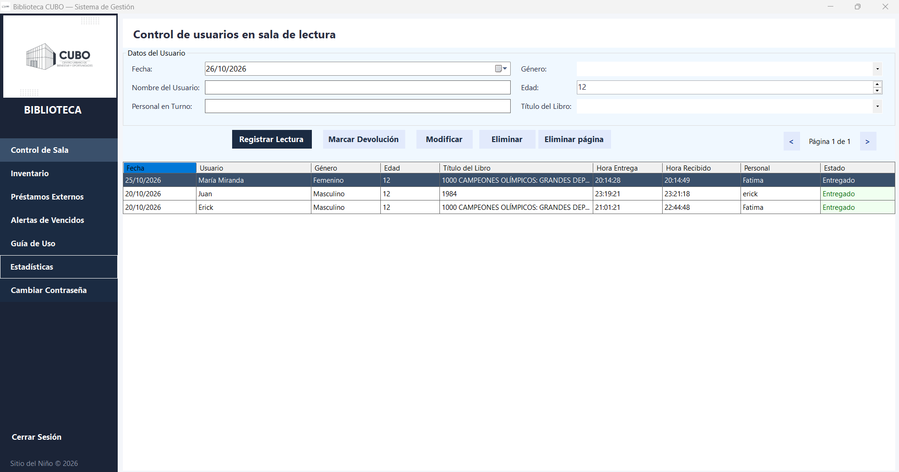
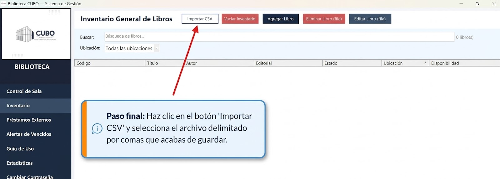
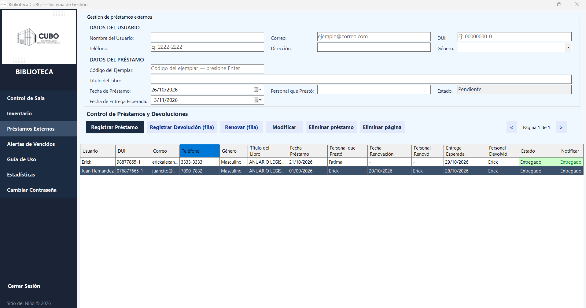
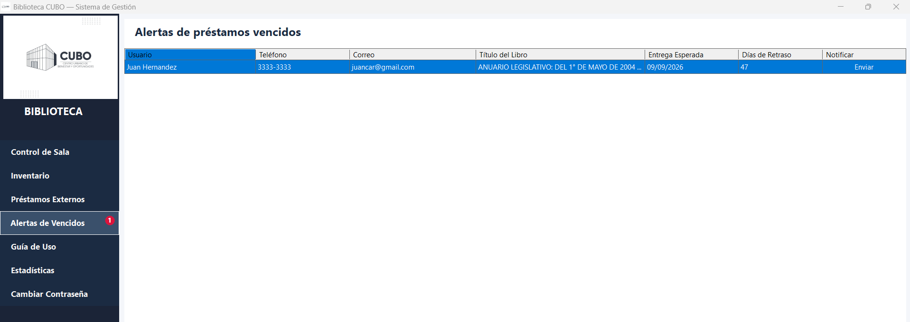
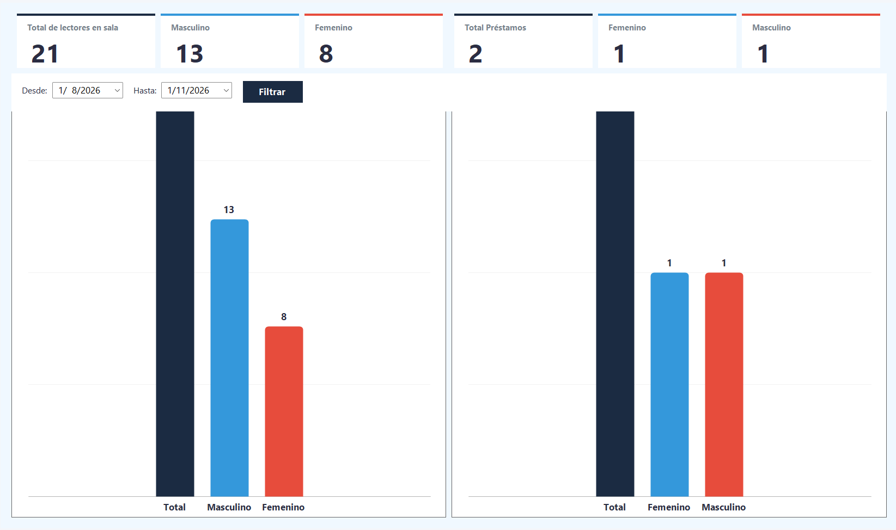

# Sistema de Gestión Bibliotecaria — CUBO Ing. Rigoberto Orellana

Sistema de escritorio integral desarrollado en **C# (.NET 10 WinForms)** para la digitalización, control de inventario y trazabilidad operativa de préstamos en el Centro Urbano de Bienestar y Oportunidades (CUBO), Sitio del Niño.

El sistema reemplaza el control manual en bitácoras físicas por una plataforma digital centralizada, optimizando los tiempos de atención, garantizando la consistencia de los datos y permitiendo la administración eficiente de más de **3,800 ejemplares**.

---

## 📌 Índice de Módulos

| # | Módulo | Propósito |
| :--: | --- | --- |
| 1 | [Control de Sala](#1-control-de-sala) | Registro de lectores en la sala de lectura |
| 2 | [Inventario](#2-inventario) | Catálogo general de libros y su disponibilidad |
| 3 | [Préstamos Externos](#3-préstamos-externos) | Préstamos, renovaciones y devoluciones |
| 4 | [Alertas de Vencidos](#4-alertas-de-vencidos) | Seguimiento de entregas atrasadas |
| 5 | [Estadísticas](#5-estadísticas) | Métricas de uso por género y rango de fechas |
| 6 | [Guía de Uso](#6-guía-de-uso) | Manual integrado dentro de la aplicación |

---

## 1. Control de Sala



Registra la entrada y salida de lectores que usan la sala presencialmente, sin préstamo para llevar. Cada registro guarda quién entró, a qué hora, con qué libro y quién lo atendió.

**Datos que captura:** fecha, nombre del lector, género, edad, título del libro y personal en turno.

**Acciones disponibles:**

* **Registrar Lectura** — da de alta una nueva entrada a sala.
* **Marca Devolución** — cierra la lectura y horada la hora de recepción.
* **Modificar** — corrige un registro existente.
* **Eliminar** / **Eliminar página** — operaciones reservadas a administradores.

**Comportamiento importante:**

* El sistema registra automáticamente **hora de entrega** y **hora recibido**.
* Cada fila tiene estado `Pendiente` (aún leyendo) o `Entregado` (ya devolvió).
* Los registros conservan el **código del ejemplar**, no solo el título, para distinguir copias iguales.
* La tabla pagina cuando hay muchos registros.

---

## 2. Inventario



Catálogo general de todos los libros de la biblioteca. Es el punto de partida del sistema: el inventario alimenta el módulo de préstamos.

**Columnas:** código, título, autor, editorial, estado físico, ubicación y disponibilidad.

**Acciones disponibles:**

* **Importar CSV** — carga el catálogo completo en la primera ejecución.
* **Agregar Libro** — alta manual de un ejemplar *(solo administradores)*.
* **Editar Libro (fila)** — corrige los datos de un ejemplar.
* **Eliminar Libro (fila)** — da de baja un ejemplar.
* **Vaciar Inventario** — borra todo el catálogo, con confirmación *(solo administradores)*.

**Comportamiento importante:**

* **Búsqueda instantánea** por título o código, y **filtro por ubicación** (`M1` … `M5`).
* Indica en todo momento cuántos libros coinciden con el filtro.
* **Doble clic sobre un libro disponible** transfiere su código y título al módulo de Préstamos y cambia de pantalla automáticamente. Si el ejemplar ya está prestado, lo advierte y no permite iniciar un préstamo.
* El catálogo se importa **una sola vez**. Si más adelante vacías el inventario, el sistema recuerda esa decisión y no vuelve a importarlo.

---

## 3. Préstamos Externos



Módulo central del sistema. Administra los libros que salen de la biblioteca y su ciclo completo: préstamo → renovación → devolución.

**Datos del usuario:** nombre, correo, DUI, teléfono, dirección y género.

**Datos del préstamo:** código del ejemplar, título, fecha de préstamo, fecha de entrega esperada, personal que prestó y estado.

**Acciones disponibles:**

* **Registrar Préstamo** — alta del préstamo.
* **Registrar Devolución (fila)** — cierra el préstamo y devuelve el ejemplar a `Disponible`.
* **Renovar (fila)** — extiende el plazo y registra quién renovó.
* **Modificar** — corrige los datos de un préstamo.
* **Eliminar préstamo** / **Eliminar página** — operaciones reservadas a administradores.

**Comportamiento importante:**

* Al capturar los datos del usuario, el sistema **calcula la fecha de entrega sumando 8 días**. El plazo es orientativo y puede ampliarse manualmente.
* **Trazabilidad completa:** guarda quién prestó, quién renovó y quién recibió, en columnas independientes.
* Estados con código de color: `Pendiente` (rojo), `Renovado` (celeste) y `Entregado` (verde).
* **Validación de disponibilidad:** si no queda ningún ejemplar libre del título, no permite registrar el préstamo.
* Requiere nombre, DUI, código del ejemplar y personal que prestó para dar de alta.
* La columna **Notificar** abre el cliente de correo del equipo con asunto y cuerpo ya redactados; al enviarlo, la fila pasa a `Enviado`.

---

## 4. Alertas de Vencidos



Listado de morosos: préstamos cuya fecha de entrega ya pasó y siguen sin devolverse.

**Columnas:** usuario, teléfono, correo, título del libro, entrega esperada, **días de retraso** y notificación.

**Comportamiento importante:**

* Los **días de retraso se calculan dinámicamente** cada vez que se abre la pantalla.
* El botón **Enviar** de cada fila abre el cliente de correo con un recordatorio de entrega ya redactado.
* La barra lateral muestra un **contador de alertas** con un distintivo rojo, que se actualiza solo cada 30 segundos y también al registrar o devolver un préstamo.

---

## 5. Estadísticas



Resumen cuantitativo del uso de la biblioteca.

**Seis indicadores en tarjetas:**

| Grupo | Indicadores |
| --- | --- |
| Lectores en sala | Total, masculino, femenino |
| Préstamos externos | Total, femenino, masculino |

**Comportamiento importante:**

* Filtro por rango de fechas (**Desde** / **Hasta**) que recalcula tanto las tarjetas como los gráficos.
* Dos gráficos de barras comparativos: distribución de lectores en sala y de préstamos por género.

---

## 6. Guía de Uso

Manual del operador accesible desde la barra lateral, sin salir de la aplicación. Describe paso a paso el flujo de préstamos, la importación del catálogo, el uso de la ubicación física y las estadísticas.

---

## 🛠️ Stack Tecnológico

| Componente | Tecnología |
| --- | --- |
| Lenguaje | C# (.NET 10) |
| Interfaz gráfica | Windows Forms, diseño modular basado en `UserControls` |
| Persistencia de datos | SQLite mediante `Microsoft.Data.Sqlite`, sin ORM |
| Seguridad de contraseñas | PBKDF2-SHA256, 100.000 iteraciones, salt aleatorio de 128 bits |
| Control de acceso | Roles `Administrador` y `Operador`, con reautenticación para acciones destructivas |
| Empaquetado | Inno Setup 6, instalador autocontenido |
| Control de versiones | Git / GitHub |

---

## 📁 Estructura del Proyecto

```
Proyecto-Limpio/
├── BibliotecaApp.slnx                Solución de Visual Studio
├── BibliotecaApp/
│   ├── Program.cs                    Punto de entrada e inicialización de la BD
│   ├── SesionGlobal.cs               Estado de sesión y roles
│   ├── Comun/                        Estilo de interfaz, hash, recursos embebidos
│   ├── Controles/                    Los 6 módulos (UserControls)
│   ├── Datos/                        Conexión SQLite, migraciones, lector CSV
│   └── Vistas/                       Ventanas: login, principal, gestión de usuarios
├── docs/capturas/                    Capturas de pantalla
├── instalador/setup.iss              Script de Inno Setup
└── Script SQL - Reset Inventario y Prestamos.sql
```

---

## ⚙️ Instalación y Ejecución

Hay **dos formas** de poner el sistema en marcha. Elige la que mejor se ajuste a tu caso.

### Opción A — Instalador (recomendada para el equipo de la biblioteca)

Ideal para PC de producción, donde solo se necesita usar el sistema.

**Requisitos**

* Windows 10 / 11 (x64). **No requiere instalar .NET**: el motor viaja embebido.

**Pasos**

1. Ejecute `instalador/BibliotecaCUBO-Instalador-1.0.exe`.
2. Siga el asistente. Se instala en `C:\Program Files\BibliotecaCUBO`.
3. Marque la opción de acceso directo en el escritorio si lo desea.
4. Pulse **Finalizar** para abrir el sistema.

**Notas**

* La instalación es **autocontenida**: incluye el runtime completo de .NET 10.
* La base de datos vive en `%APPDATA%\BibliotecaCUBO` y **no se elimina al desinstalar**, a propósito, para conservar el historial.

<details>
<summary><b>Compilar el instalador desde el código fuente</b></summary>

```bash
# 1. Publicar la aplicación en modo autocontenido
dotnet publish BibliotecaApp/BibliotecaApp.csproj ^
    -c Release -r win-x64 --self-contained true -o instalador/app

# 2. Compilar el setup con Inno Setup 6
"C:\Program Files (x86)\Inno Setup 6\ISCC.exe" instalador\setup.iss
```

La salida queda en `instalador/bin/Instalador-BibliotecaCUBO-1.0.0.exe`.

</details>

---

### Opción B — Compilar desde el código fuente

Ideal para desarrollo o modificación del sistema.

**Requisitos**

* Sistema operativo Windows 10 / 11
* [.NET 10 SDK](https://dotnet.microsoft.com/download) **o** Visual Studio 2022 con la carga de trabajo *Desarrollo de escritorio .NET*

**Pasos**

```bash
# 1. Clonar el repositorio
git clone https://github.com/Mirandasv001/sistema-bibliotecario-cubo-orellana.git
cd sistema-bibliotecario-cubo-orellana

# 2. Compilar
dotnet build BibliotecaApp/BibliotecaApp.csproj -c Release

# 3. Ejecutar
dotnet run --project BibliotecaApp/BibliotecaApp.csproj
```

**Alternativa con Visual Studio**

1. Abra `BibliotecaApp.slnx` en Visual Studio 2022.
2. Seleccione la configuración `Release`.
3. Pulse **F5** (ejecutar) o **Ctrl+Shift+B** (compilar solución).

---

**Cómo se compara cada opción**

| | Opción A — Instalador | Opción B — Compilar |
| --- | --- | --- |
| Destino | PC de producción | Desarrollo y pruebas |
| Requiere SDK | No | Sí |
| Tiempo de preparación | Minutos | Requiere clonar y compilar |
| Permite modificar el código | No | Sí |
| Actualización | Reinstalar | Volver a compilar |

---

## 🔑 Datos de Acceso Iniciales

Se generan automáticamente en la primera ejecución, cuando la base de datos está vacía:

| Rol | Usuario | Contraseña |
| --- | --- | --- |
| Administrador | `AdminCubo` | `Admin123$` |
| Operador | `UserCubo` | `1234$` |

> ⚠️ **Cambie la contraseña del administrador apenas entre al sistema**, desde el menú **Cambiar Contraseña** de la barra lateral.

**Qué puede cada rol:**

| Acción | Administrador | Operador |
| --- | :--: | :--: |
| Registrar y modificar préstamos, devoluciones y sala | ✅ | ✅ |
| Consultar inventario y estadísticas | ✅ | ✅ |
| Agregar, editar y eliminar libros | ✅ | ❌ |
| Vaciar inventario | ✅ | ❌ |
| Eliminar registros y páginas | ✅ | ❌ |

---

## 💾 Ubicación de los Datos

La base de datos se crea en la primera ejecución en:

```
%APPDATA%\BibliotecaCUBO\biblioteca.db
```

**Sobre el catálogo CSV:** el archivo `catalogo_cubo.csv` se importa **únicamente en la primera ejecución**, es decir, cuando la base de datos está vacía. Si la importación falla, la aplicación arranca igualmente y el inventario queda bajo tu control (puede cargarse después con **Importar CSV**).

**Sobre la desinstalación:** no borra la base de datos. Para eliminarla también, hágalo manualmente borrando la carpeta indicada arriba.

Si necesitas reiniciar el inventario y los préstamos a su estado inicial sin borrar el resto de la información, existe el script `Script SQL - Reset Inventario y Prestamos.sql`.

---

## 👤 Autor

**Erick Miranda** — [@Mirandasv001](https://github.com/Mirandasv001)

Estudiante de Ingeniería en Desarrollo de Software
